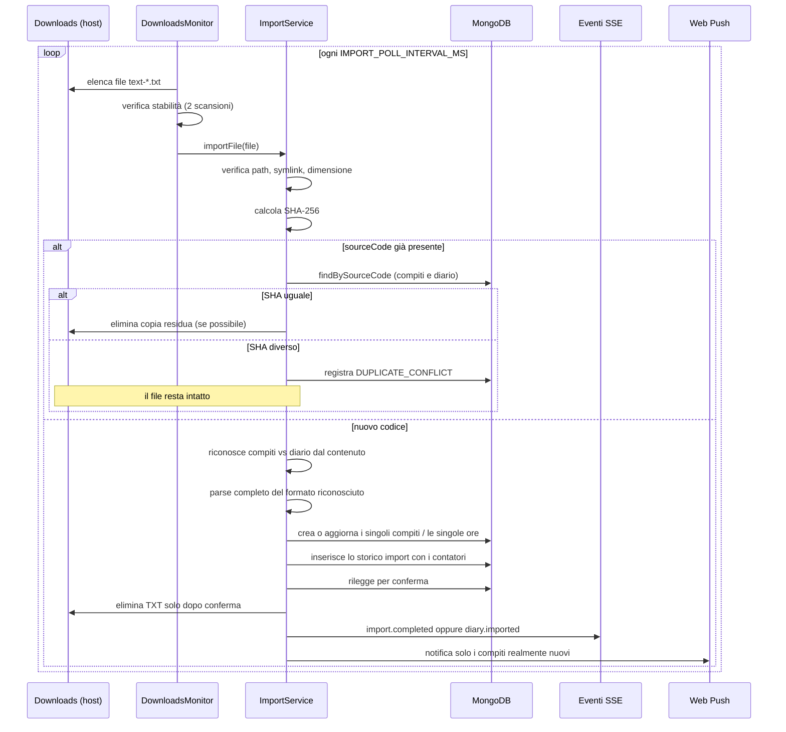
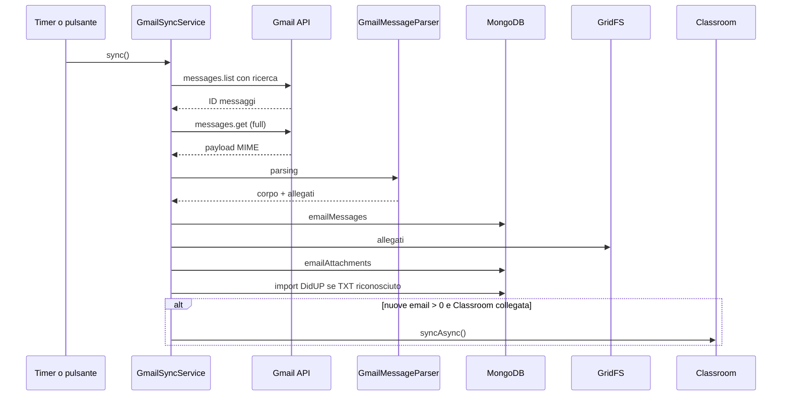
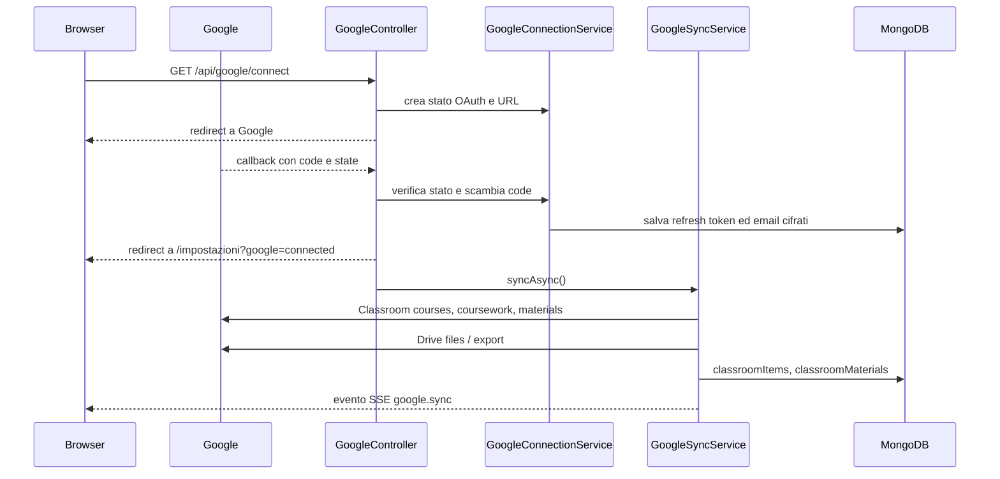

# Architettura

## Obiettivi

MIDA è un'applicazione self-hosted per una singola famiglia o un singolo utente. Le priorità di progetto sono:

1. **Non perdere compiti**: un file viene eliminato solo dopo che il salvataggio è stato confermato.
2. **Non duplicare compiti**: ogni file DidUP ha un codice e un'impronta SHA-256; le regole di deduplicazione sono esplicite.
3. **Essere resistente**: un errore di parsing, un problema di permessi o un client SSE disconnesso non devono bloccare il resto.
4. **Funzionare in locale**: nessun servizio cloud, nessun account, nessun dato inviato all'esterno.

## Componenti

### Backend (`backend/`)

Applicazione Spring Boot 4.1.2 con Java 25.

| Package | Responsabilità |
| --- | --- |
| `it.mida.config` | Proprietà tipizzate, configurazione async, OpenAPI, indici MongoDB. |
| `it.mida.parser` | Riconoscimento nome file, riconoscimento del formato, parser DidUP compiti e diario, interpretazione date scolastiche. |
| `it.mida.imports` | Polling della directory, importazione atomica di compiti e diario, stato del monitor, eliminazione sicura. |
| `it.mida.homework` | Documento MongoDB dei compiti, repository, query aggregation, comando di completamento. |
| `it.mida.diary` | Documento MongoDB del diario, repository, query aggregation per attività e giorni. |
| `it.mida.issues` | Anomalie con fingerprint e deduplicazione delle segnalazioni. |
| `it.mida.events` | Hub SSE in-process e pubblicazione degli eventi. |
| `it.mida.notifications` | Preferenze, VAPID, invio Web Push, promemoria, deduplicazione consegne. |
| `it.mida.google` | OAuth Google, cifratura credenziali, sincronizzazione Gmail/Classroom. |
| `it.mida.attachments` | GridFS e download degli allegati. |
| `it.mida.google` | OAuth Google, cifratura credenziali, sincronizzazione Classroom. |
| `it.mida.google.email` | Modello email/allegati, query e import dei TXT DidUP. |
| `it.mida.google.classroom` | Corsi, compiti, materiali, annunci e download Drive. |
| `it.mida.common` | Gestione errori Problem Details, paginazione, eccezioni comuni. |
| `it.mida.*.api` | Controller REST, DTO e query object. |

### Frontend (`frontend/`)

Applicazione Angular 21 standalone con:

- `core/homework-store.ts`: stato centrale con Signals, filtri, caricamento calendario, completamento ottimistico, gestione eventi SSE.
- `core/live-updates.service.ts`: connessione SSE con backoff esponenziale, rilevamento online/offline e riallineamento.
- `core/push.service.ts`: permessi, registrazione del service worker, sottoscrizione PushManager, test e disattivazione.
- `pages/calendar`: calendario FullCalendar e pannello di dettaglio.
- `pages/diary`: registro delle attività svolte, navigazione per giorno e filtri.
- `pages/dashboard`: riepilogo e prossime consegne.
- `pages/imports`: storico e anomalie.
- `pages/settings`: preferenze di notifica, push, stato del monitor, account Google.
- `pages/mail`: email Gmail, allegati scaricabili e materiali Classroom.
- `core/mail-store.ts`: stato Gmail/Classroom, sincronizzazioni, email, Classroom e allegati.

### Infrastruttura

- `mida-mongodb`: MongoDB 8, volume `mida-mongodb-data`, nessuna porta host.
- `mida-backend`: Java 25 JRE, utente non-root, legge `/imports`, nessuna porta host.
- `mida-frontend`: build Angular servita da nginx, accessibile su `127.0.0.1:8200` per lo sviluppo locale.
- `mida-proxy`: nginx separato che espone `https://maximilianclassroom.com:4443`, inoltra `/api` e Swagger al backend e la SPA al frontend.
- Rete Docker `mida-internal`: solo i quattro servizi possono comunicare tra loro.

## Flusso di importazione



### Perché il polling

Su Docker Desktop per macOS i bind mount non propagano in modo affidabile tutti gli eventi di `WatchService`. Il polling con scansioni di stabilità è più semplice da verificare e non dipende dal filesystem nativo.

### Deduplicazione

La chiave logica di un file è il `sourceCode` estratto dal nome. Il contenuto è identificato dallo SHA-256.

- `sourceCode` è univoco in `homeworkImports` e in `diaryImports`.
- Lo SHA-256 identifica il contenuto: lo stesso file condiviso con un nuovo codice non viene importato una seconda volta.
- Un documento esistente con SHA uguale non viene riscritto.
- Un documento esistente con SHA diverso produce un conflitto visibile.
- Un codice già usato dall'altro tipo di file produce un conflitto.
- Il suffisso numerico del nome file è conservato solo per lo storico.

### Eliminazione sicura

Prima di eliminare, il servizio rilegge il file e verifica che lo SHA-256 coincida ancora con quello importato. Se il file è cambiato, non viene eliminato e viene registrata un'anomalia.

Se l'eliminazione fallisce, il file resta; alla scansione successiva il flusso `ALREADY_IMPORTED` ritenta l'eliminazione senza creare un nuovo documento.

### Anomalie

Le anomalie hanno una fingerprint `tipo|filename|sha256` univoca. Un file invariato che ha già prodotto un errore non viene riprocessato a ogni polling; viene ritentato solo se cambia il contenuto.

## Gmail e Classroom

### Gmail



Il polling Gmail è ogni 5 minuti di default. Le email sono identificate dall'ID Gmail; gli allegati da una chiave composta con il messaggio.

### Classroom

Classroom non ha un polling autonomo. La sincronizzazione parte dopo il collegamento OAuth, quando Gmail trova una nuova email, oppure manualmente. Questo riduce le chiamate API.



La sincronizzazione è idempotente: le email sono identificate da `providerMessageId`, gli elementi Classroom da `classroomKey`, gli allegati da una chiave composta con il rispettivo provider.

## Modello dati e lettura

MongoDB conserva un documento per compito, uno per ora del diario e un documento di storico per ogni file:

```text
homeworkAssignments
  _id
  contentHash (unique)
  slotKey
  baseKey
  descriptionHash
  assignedDate, dueDate
  subject, teacher, description
  completed, completedAt
  revision
  importId, firstImportId
  sourceCode, originalFilename, importedAt
  firstSeenAt, lastSeenAt, updatedAt

diaryEntries
  _id
  activityDate + period (unique composto)
  subject, teacher, description
  contentHash, revision
  importId, firstImportId
  sourceCode, originalFilename, importedAt
  firstSeenAt, lastSeenAt, updatedAt

homeworkImports / diaryImports
  _id, sourceCode (unique), sha256
  importedAt, schoolYearStart
  assignmentCount / entryCount
  createdCount, updatedCount, unchangedCount
```

Le API di lettura interrogano direttamente `homeworkAssignments` e `diaryEntries`: filtri, paginazione e ordinamento usano i campi del singolo documento. Non servono più `$unwind` né proiezioni degli array.

Il completamento aggiorna un solo documento:

```javascript
db.homeworkAssignments.updateOne(
  { _id: assignmentId },
  { $set: { completed: true, completedAt: new Date() } }
)
```

Un'eventuale compito identico ritrovato in un altro file non viene riscritto: il writer confronta `contentHash`, `slotKey` e `baseKey` prima di decidere se creare, aggiornare o lasciare invariato. Lo stato `completed` non viene mai azzerato da una nuova esportazione.

## SSE

`MidaEventPublisher` mantiene un set concorrente di `SseEmitter`. Ogni invio è isolato: un emitter rotto viene rimosso senza interrompere gli altri.

Eventi:

- `connected` all'apertura;
- `import.completed` per i compiti, `diary.imported` per il diario;
- `homework.updated`, `import.issue`, `import.status`;
- heartbeat periodico.

Il frontend riconnette con backoff esponenziale (1–30 secondi), ascolta `online`/`offline` e, alla riconnessione, ricarica calendario e dati di riferimento. Un errore SSE non blocca mai l'importazione: gli eventi sono un canale di aggiornamento, non la fonte di verità.

## Web Push

1. Il backend genera una coppia VAPID al primo avvio, oppure usa le chiavi fornite da ambiente.
2. Il browser chiede il permesso solo dopo un'azione esplicita dell'utente.
3. `PushManager.subscribe()` usa la chiave pubblica VAPID.
4. Il frontend invia endpoint e chiavi al backend.
5. Il backend registra una riga in `pushSubscriptions`.
6. Prima di inviare, crea una riga in `notificationDeliveries` con `dedupKey` univoca.
7. Invia il payload al servizio push del browser.
8. Se la risposta è `404`/`410`, disattiva la sottoscrizione.

La deduplicazione persistente impedisce duplicati dopo un riavvio o in caso di esecuzioni sovrapposte.

## Sicurezza

- Il frontend pubblica una porta solo su `127.0.0.1`; il proxy HTTPS pubblica `4443`.
- MongoDB e backend sono sulla rete interna Docker.
- nginx applica CSP e header di sicurezza; il proxy HTTPS termina TLS.
- Il backend valida i path: solo file direttamente nella directory configurata.
- I link simbolici sono ignorati.
- Le dimensioni dei file e le chiavi push sono validate.
- Le chiavi VAPID private non vengono loggate.
- Il refresh token Google e l'indirizzo dell'account sono cifrati con AES-256-GCM; l'access token resta solo in memoria.
- Gli stati OAuth sono monouso, con scadenza e TTL MongoDB.
- L'HTML delle email non viene conservato né renderizzato: solo testo.
- Gli allegati sono scaricati tramite identificativi opachi, mai tramite percorsi.
- `.env` è escluso dal repository.
- Email e allegati sono dati sensibili: senza autenticazione MIDA va usata solo in locale e MongoDB non va pubblicato sull'host.

## Scelte e compromessi

- **Un documento per compito e per ora**: elimina alla radice i duplicati tra esportazioni diverse, ma richiede un riconoscimento semantico delle revisioni. Lo storico dei file resta separato per audit e deduplicazione dei file.
- **Polling**: più semplice e affidabile dei watch event su Docker Desktop macOS, al costo di un piccolo ritardo (5 secondi di default).
- **SSE in-process**: sufficiente per una singola istanza; non scala a più backend senza un bus condiviso.
- **Nessun login**: adeguato per l'uso locale; non adatto a esposizione pubblica.
- **VAPID in MongoDB**: evita di perdere le sottoscrizioni dopo un riavvio, ma richiede di non cancellare il volume.
